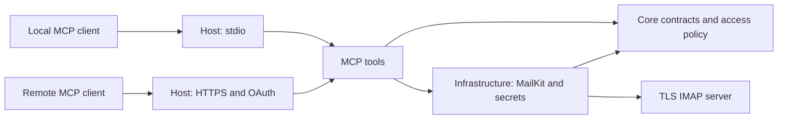

# Architecture

Status: accepted by OBS-IT on 2026-10-25. Implementation is authorized; feasibility gates remain mandatory.

Extensions accepted 2026-10-28: [Windows credential setup](Decisions/0006-windows-credentials.md) and [opt-in local inbox cleanup](Decisions/0007-local-inbox-cleanup.md). The latter is a local operator CLI operation outside the eight read-only MCP tools; it requires separate global/account permission and exact-sender/Trash policy.

## Structure and dependencies

```text
OBS-IT.IMAP.slnx
src/
  OBS.IMAP.Core/                 Contracts, models, validation, access policy
  OBS.IMAP.Infrastructure/       MailKit sessions, MIME reads, secret providers
  OBS.IMAP.MCP/                  Shared tool definitions and result mapping
  OBS.IMAP.Host/                 Composition, stdio or ASP.NET Core startup
tests/
  OBS.IMAP.Core.Tests/
  OBS.IMAP.Infrastructure.Tests/
  OBS.IMAP.MCP.Tests/
  OBS.IMAP.Integration.Tests/
docs/
  Decisions/
docker/                         Future Dockerfile and test-server compose file
examples/                       Future redacted configuration and client examples
.github/workflows/              Future CI and release workflows
```

The production projects and matching test projects are implemented. An isolated `spikes/OBS.IMAP.Feasibility` project preserves protocol checks. Distribution files and examples are present. The checkout directory name is unchanged; solution and artifacts use OBS-IT branding.



Compile-time references: Core has no MCP or MailKit dependency; Infrastructure references Core; MCP references Core only; Host references all three and wires implementations through DI. The diagram's Tools-to-Infrastructure edge denotes runtime calls through Core interfaces. No service locator, event bus, database, or generic repository is needed. Future REST endpoints can call the same authorized Core service contracts.

Use a small read service contract, a credential provider, and a request access context. Core DTOs must not expose MailKit/MimeKit objects. Enforce account authorization in the service boundary, not only the tool wrapper. Host supplies an immutable local or remote identity; callers cannot supply their own identity claims through tool arguments.

## Tool contracts

The read tools carry SDK read-only annotations. Results use structured DTOs with explicit truncation and continuation indicators. A message reference contains account ID, exact folder identifier, UIDVALIDITY, and nonzero UID.

| Tool | Inputs and result |
| --- | --- |
| `list_accounts` | Authorized IDs and display names only; no hosts, usernames, or credential references |
| `list_folders` | Account, optional parent and continuation; bounded folder descriptors |
| `get_folder_info` | Account and folder; counts, delimiter, attributes, UIDVALIDITY |
| `search_messages` | Account, folder, typed filters, page size and opaque continuation; summary page |
| `get_message_headers` | Message reference; allowlisted envelope and threading headers with length caps |
| `get_message` | Message reference; plain text by default, optional HTML, bounded content and structure |
| `get_message_structure` | Message reference; MIME tree and attachment metadata without attachment bytes |
| `get_attachment` | Message reference and MIME part ID; capped base64 data with media type and byte count |

Folder identifiers are server folder names represented as opaque data, not filesystem paths. Verify existence and policy on every request. Attachment part IDs must belong to that message's fetched structure. Filenames are display data only. Return Message-ID, In-Reply-To and References as thread hints. Do not promise a complete conversation or fetch adjacent messages automatically.

Folder discovery without a parent lists all personal namespaces and deduplicates overlapping names. A named MIME part is treated as an attachment even if its disposition is inline. Named text parts are available through explicit attachment retrieval.

Search supports sender, recipient (To/Cc), subject, body/text, internal received date bounds, read/unread and flagged/unflagged. Combine supplied filters with AND; reject contradictions. Use MailKit typed SearchQuery construction, never raw IMAP fragments. Dates are inclusive lower and exclusive upper IMAP calendar-day bounds; document server timezone/precision limitations. UID descending order is deterministic, but is not necessarily Date-header order.

## Local writes

The stdio host registers each write tool if at least one locally granted account enables its operation. The write service rechecks the transport identity, account grant and operation flag on every call. See [local MCP writes](Configuration.md#local-mcp-writes) for configuration.

Move and Trash use a single native UID MOVE under the serialized account lease. The service checks UIDVALIDITY and verifies the UID exists before issuing MOVE. Draft creation uses APPEND with the Draft flag. A write result includes the destination folder and a message reference when the server returns an authoritative destination UID and UIDVALIDITY.

SMTP submission uses its own configured endpoint and credentials. When required, MCP form elicitation shows the recipient, sender, subject and body before any SMTP network access. A failed or unavailable confirmation blocks submission. The send result identifies the message accepted by the SMTP server. Network interruptions during a write can produce `write_outcome_unknown`. Inspect the mailbox or submission provider before trying the same operation again.

## Bounded search and continuation

Do not call an unrestricted SEARCH ALL and paginate its entire UID list in memory. Search bounded numeric UID intervals, starting at a captured UIDNEXT minus one and moving downward; filter server-side within each interval. A proposed maximum 10,000-wide UID interval caps potential UID results per command. Scan at most 20 intervals per request and fetch only the requested summary page. Sparse folders may produce a short or empty page with continuation; this is not end-of-results. No expensive exact total count is promised.

A fresh scan reselects the mailbox read-only to refresh the starting boundary. If the server omits UIDNEXT, fetch only the UID of the last message in a nonempty mailbox. Continuations keep the boundary captured by the first page.

The authenticated continuation encodes version, account/folder, UIDVALIDITY, initial upper UID, next interval and position, canonical filter hash, principal binding and expiry. It must resume within an interval when a page fills. Validate all fields, then reapply current authorization. Use a per-process random signing key initially: restarts invalidate cursors with a restart-search error. No mailbox snapshots are stored. New messages beyond the initial upper UID are excluded; expunged messages disappear and flag changes can affect later matches. UIDVALIDITY changes invalidate the cursor and all message references.

## Connections and reliability

One serialized reusable authenticated IMAP session per active account initially; lazy creation, global active-session cap, bounded waiting queue, idle eviction. Never use one ImapClient concurrently. Lease includes folder selection and the whole operation to prevent cross-folder races. Open folders read-only and use BODY.PEEK semantics so retrieval never sets Seen. Future pooling requires evidence of contention.

Propagate CancellationToken through DNS/connect/auth/search/fetch and decoding. Deadline includes queueing. On cancellation during protocol I/O or a connection failure, discard the session rather than return potentially desynchronized state. Permit at most one reconnect retry for idempotent reads within the same deadline; do not retry invalid credentials or policy failures. Re-check UIDVALIDITY after reconnect. Graceful shutdown stops admissions, cancels pending work, and disposes sessions within a bounded grace period.

Retrieve envelope, size and BODYSTRUCTURE first, then selected MIME parts. Avoid whole-message GetMessage calls for multipart attachments. Enforce network byte and decoded byte ceilings while streaming; advertised sizes are not trustworthy. Fail oversized attachments without returning partial binary data. Text truncation must report truncation explicitly. If a MailKit path cannot enforce limits before allocation, it must not be used until a bounded alternative passes the spike.

Safe error codes: invalid_input, access_denied, not_found, stale_reference, invalid_cursor, limit_exceeded, timeout, authentication_failed and provider_unavailable. Sanitize server errors; attach a generated correlation ID, not raw exception text. HTTP authentication failures retain proper 401/403 semantics. Logs contain operation names, safe account IDs, latency and error codes, never bodies or query values.

## Alternatives

One Host with mutually exclusive modes avoids duplicate bootstrap/configuration. Separate hosts would reduce package loading but add maintenance; reconsider only if packaging measurements justify it. Use external OAuth authorization infrastructure instead of inventing an identity server. Bounded UID scanning sacrifices date ordering and sometimes fills fewer results, but avoids relying on optional ESEARCH/SORT support. No local indexing avoids persistence, synchronization and deletion complexity. See the ADRs and [research](ClientCompatibility.md).
